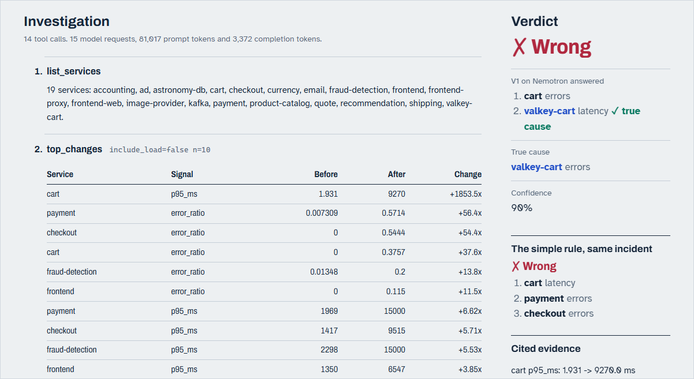

# RootCause

RootCause is an LLM agent that investigates microservice incidents over OpenTelemetry metrics, traces and logs, and a benchmark that asks whether it beats a simple rule. Every answer is scored against ground truth on 20 recorded [OpenTelemetry Demo](https://github.com/open-telemetry/opentelemetry-demo) incidents (16 faults, 4 no-fault controls), against a 28-line heuristic that names the service whose fault signal rose most.

**The result, honestly:**
- **No agent is clearly better than the heuristic.** Every paired 95% interval against it includes 0.
- **The model matters more than the tools on fault incidents.** With the same prompt and tools, agent v1 on Nemotron 3 Super scores +0.26 higher than on Gemini 3.5 Flash-Lite (95% interval +0.10 to +0.44).
- **Counting the 4 no-fault controls, that gap shrinks to +0.11 and its interval includes 0** (-0.09 to +0.31), because Nemotron raises far more false alarms.
- **The change-aware tools change nothing measurable** on either model.

| solver | model | tools | fault incidents (16) | controls answered correctly (4) | runs |
|---|---|---|---|---|---|
| heuristic | none | change ranking | 0.59 | 0.75 | 1 per incident |
| agent v0 | Gemini 3.5 Flash-Lite | naive | 0.47 | 1.00 | 5 per incident |
| agent v1 | Gemini 3.5 Flash-Lite | change-aware | 0.41 | 1.00 | 5 per incident |
| agent v0 | Nemotron 3 Super | naive | 0.69 | 0.30 | 5 per incident |
| agent v1 | Nemotron 3 Super | change-aware | 0.68 | 0.50 | 5 per incident |

Accuracy is the mean over incidents of each incident's mean score across its runs.

Every run can be replayed on the [replay site](https://kshitizj03.github.io/rootcause/). The tables behind every number are in [`docs/results/report.md`](docs/results/report.md), what they mean is in [`docs/results/agents.md`](docs/results/agents.md), and the threats to validity are in the [methodology FAQ](docs/faq.md).

## Quick start

Python 3.11. In a virtual environment (create it with `python -m venv .venv`, or `python3 -m venv .venv` where `python` is not Python 3, then activate it: `.venv\Scripts\activate` on Windows, `source .venv/bin/activate` on macOS/Linux):

```
pip install -e .
rootcause fetch-data
rootcause eval heuristic
```

- `pip install -e .` installs the package and the `rootcause` command. It must be editable (`-e`), because the package reads `scenarios/` and `data/` from this checkout.
- `rootcause fetch-data` downloads the data release (the 20 recorded snapshots and every run record behind the report), checks its SHA-256 and unpacks it into `data/`. It comes from the [`data-v1` release](https://github.com/kshitizj03/rootcause/releases/tag/data-v1), and its checksum is pinned in `rootcause/config.py`. Offline, pass a downloaded copy with `rootcause fetch-data --from rootcause-data-v1.zip`.
- `rootcause eval heuristic` scores the heuristic and prints its summary. Batches are resumable, so with the released records in place it adds no runs; delete `data/runs/heuristic` to score it from scratch. The agents need an API key (see [Score the solvers](#score-the-solvers)).

## Status

> - **Complete:** the heuristic; agents v0 and v1 on Gemini 3.5 Flash-Lite and on Nemotron 3 Super (5 runs on each of the 20 incidents); on Nemotron, the no-priors, vague-alert and 30-step ablations.
> - **Running:** the Gemini vague-alert ablation (quota-bound on the free tier; the Gemini no-priors ablation is queued after it) and agent v1 on GLM 5.3 Flash. [`report.md`](docs/results/report.md) marks them as partial; no conclusions are drawn from them yet. Other models that were tried and not run (timeouts) are listed under [Models tried](docs/results/agents.md#models-tried).
> - Two small decision models, Laya and Hunch, both scored below the heuristic zero-shot, so no small-model-then-agent cascade was built ([`laya.md`](docs/results/laya.md), [`hunch.md`](docs/results/hunch.md)).

## How it works

The scoring rules were fixed before the first run, there are no-fault controls, each agent batch is planned for 5 runs per incident (3 for the Gemini ablations), and a held-out split is kept out of tuning (one exception, disclosed under Provenance in the report).

```
 OpenTelemetry Demo (28 services, Docker)
   │  inject a fault (feature flag / docker pause / CPU cap) ─► wait ─► capture ─► restore
   ▼
 incident snapshot  (metrics series + sanitised traces + sanitised logs; ground truth stored separately)
   │
   ├─► heuristic baseline ── "which service's fault signal rose most?"
   └─► LLM agent (Gemini or Nemotron) ── tool loop: top_changes, service_map, search_traces, search_logs, ...
              │                                    (same tools also served over MCP)
              ▼
   report {verdict, ranked causes, evidence[], confidence}
              │
   score (fixed rules) + evidence check (do the cited metrics, traces and log lines exist?)
```

**1. Incident library.** There are 20 scenarios: 16 faults plus 4 no-fault controls, each injected once, live, into the [OpenTelemetry Demo](https://github.com/open-telemetry/opentelemetry-demo) and recorded as a self-contained snapshot. The fault categories are:
- **easy:** one loud fault;
- **cross-service:** the symptom shows up in a different service from the cause;
- **silent:** latency or resource faults with no errors;
- **noisy:** a real fault plus a decoy traffic flood;
- **two-fault:** both causes must be named.

Before a recording counts, metric checks confirm the fault really showed up. [`scenarios/NOTES.md`](scenarios/NOTES.md) records every outcome, including the scenarios that were dropped and why.

**2. Leak-proofing.** Faults are injected through the demo's feature flags, and the demo's own telemetry repeatedly names them: flag evaluation events, the flag service's traces, flag names in log lines, an attribute whose value is `true` only during one fault, Envoy's `DI` ("delay injected") marker, timing quirks in metadata, and alert wording. Each channel was found and closed, and all of them are listed in `scenarios/NOTES.md`.

The automated leak scan checks every snapshot's metrics, spans and logs, which covers the first five channels. The timing quirk and the alert wording were fixed by migrating the snapshots and rewriting the alerts. The snapshots an agent sees contain no scenario names, no flag vocabulary and no ground truth.

**3. Solvers.**
- **Heuristic:** ranks every service's error ratio, p95 latency, peak memory, CPU and restarts by how much each rose compared with a 15-minute baseline. It names the top one. Its threshold was fixed in advance.
- **Agent v0:** a model tool loop with naive tools (raw metric series, trace and log search).
- **Agent v1:** the same loop with change-aware tools (`top_changes`, `service_health`, `service_map`) and structured, checkable evidence.
- **Ablations of agent v1,** each changing one thing: *no priors* drops the two generic sentences from the prompt ("the service the alert mentions is often NOT the cause", "it is possible that nothing is actually wrong"), and *vague alert* gives every incident the same alert, "Users report that something is wrong with the shop." On Nemotron both are complete, plus a third ablation with a 30-step limit instead of 15; on Gemini both are in progress.

The agents run on two model families, both at temperature 0: Gemini 3.5 Flash-Lite (free tier) and Nemotron 3 Super (`nvidia/nemotron-3-super-120b-a12b`, NVIDIA's free trial endpoint). One model is pinned per batch, so results never mix models.

**4. Scoring.** The rules were written before any run (`rootcause/score.py`):
- top-ranked cause in the accepted set;
- partial credit on two-fault scenarios;
- `no_incident` is the only right answer on a control;
- abstaining counts as wrong.

Two outputs show the measures, as means across runs (accuracy also with its spread across runs):
- `python -m rootcause summary <solver>` prints, per category, accuracy, top-3, fault type (cause and type both right), false alarms, abstentions and the evidence measures;
- [`docs/results/report.md`](docs/results/report.md) has accuracy per category, false alarms, abstentions, evidence, cost, the paired comparisons, the step-limit table, run-to-run agreement and calibration.

The two evidence measures are:
- **grounded:** the cited metric, trace or log line exists in the incident window;
- **distinctive:** it also points at something anomalous.

## Replay site

A static site replays every recorded run, failures included:
- **The scoreboard** shows one mark per run, for every incident and solver.
- **Each incident page** steps through the agent's investigation: every tool call and what it returned, drawn as tables and sparklines. Next to it is the verdict against the true cause, the simple rule's answer for the same incident, and the cited evidence marked grounded or not.

<picture>
  <source media="(prefers-color-scheme: dark)" srcset="docs/images/replay-dark.png">
  
</picture>

*A held-out incident agent v1 on Nemotron got wrong. Its change ranking put cart's latency at the top (about 1,850 times higher), so it named cart first and the paused valkey-cart second. The simple rule named cart too.*

```bash
python -m rootcause report    # rewrites docs/results/ from your data/runs; `git checkout docs/results` restores the published results
python -m rootcause site      # builds site/data from data/runs and copies the charts from docs/results/figures
python -m http.server 8000 -d site   # then open http://localhost:8000
```

The site is plain HTML, CSS and JS with no build step, and every URL is relative, so it can be served from any sub-path. The `site` workflow (`.github/workflows/site.yml`) publishes it to GitHub Pages on every push to `main`: it fetches the data release, runs `rootcause site` and deploys `site/`. In a fork, enable Pages with "GitHub Actions" as the source.

The site shows ground truth, so it is built after scoring and is never given to the agent or the MCP server.

## Running it

Requirements: Windows, macOS or Linux, Python 3.11; Docker (about 4 GB RAM for the demo) only to record new incidents; and, for agent runs only, a free [Gemini API key](https://aistudio.google.com/) and/or a free [NVIDIA API key](https://build.nvidia.com/). For the exact dependency versions CI uses, `pip install -r requirements-lock.txt` before `pip install -e .`. The offline test suite runs with `pip install -e ".[dev]"`, then `python -m pytest -q`.

Every `rootcause <command>` below can also be run as `python -m rootcause <command>`. Either way, `data/`, `scenarios/` and `docs/results/` are the ones in this checkout, whatever the current directory.

**Data.** The recorded snapshots and run records are not in this repository; they come with the data release (`rootcause fetch-data`, see the quick start). The commands that read `data/` (`eval`, `eval-custom`, `summary`, `report`, `site` and `mcp`) need it, or incidents you recorded yourself (below).

### Score the solvers

Put the keys in `.env` (copy `.env.example`): `GEMINI_API_KEY=...` for the Gemini solvers, and `NVIDIA_API_KEY=...` for the `*-nemotron` solvers.

```bash
rootcause eval heuristic
rootcause eval agent-v1 --runs 5          # resumable; stops cleanly on the daily free-tier quota
rootcause eval agent-v1-nemotron --runs 5 --trace file   # --trace file also writes OpenTelemetry spans of each run to data/agent_traces.jsonl
rootcause summary agent-v1 --split heldout
```

### Record new incidents

With the demo checked out under `vendor/opentelemetry-demo`, at the commit the recordings used:

```bash
git clone https://github.com/open-telemetry/opentelemetry-demo vendor/opentelemetry-demo
git -C vendor/opentelemetry-demo checkout cbaf761
rootcause up                 # start the demo's 28 containers
rootcause record --all       # ~24 min per scenario (cool-down + fault + capture)
rootcause leak-check
rootcause down               # stop the demo
```

If a recording is interrupted (Ctrl+C, a crash), run `rootcause reset-flags` before the next one: it restores the feature flags, undoes Docker pauses and CPU limits, and restarts the cool-down.

### Serve the tools over MCP

Any MCP client works. This serves one snapshot's v1 tools over stdio, with the incident's alert as the server instructions:

```bash
rootcause mcp data/snapshots/incident__<stamp>
```

In a client config, use absolute paths, with the venv's python as `command` and `["-m", "rootcause.mcp_server", "<abs snapshot dir>"]` as `args`. Set `cwd` to the repository root. Don't point an interactive session at a held-out snapshot (the scenarios in `config.HELDOUT`; find their directories in `data/snapshots/index.jsonl`), because that contaminates the held-out split.

## Benchmark your own model or agent

Both commands need the data release or your own recorded incidents (see **Data** above).

```bash
# a built-in agent on any OpenAI-compatible endpoint with tool calling; records go to data/runs/agent-v1@<model>/
rootcause eval agent-v1 --model <model> --base-url <endpoint URL> --key-env <VAR holding the key> --runs 5
# your own solver: a function that takes a snapshot and returns (report, info)
rootcause eval-custom examples.my_agent:solve --name my-agent
```

Both are scored by the same rules as the built-in solvers, and `summary`, `report` and `site` pick their records up. [`docs/benchmark.md`](docs/benchmark.md) describes what a snapshot holds, what a solver may read, the report schema, the scoring rules, the splits and the rules for honest use. [`CONTRIBUTING.md`](CONTRIBUTING.md) covers adding scenarios and built-in solvers.

## Repository layout

| Path | What |
|---|---|
| `rootcause/cli.py`, `__main__.py`, `config.py` | command line (`python -m rootcause ...`) and project-wide settings |
| `rootcause/stack.py`, `backends.py`, `signals.py` | the demo's Docker Compose stack; Prometheus, Jaeger and OpenSearch clients; per-service signals and scenario checks |
| `rootcause/inject.py`, `harness.py`, `snapshot.py` | fault injection with guaranteed restore, cool-down, capture |
| `rootcause/sanitize.py` | leak filters and the leak scanner |
| `rootcause/scenarios.py`, `scenarios/` | scenario definitions and validation rules; the YAML files and `NOTES.md` |
| `rootcause/score.py`, `evaluate.py` | report validation, scoring, resumable runs, per-category summaries |
| `rootcause/summary.py`, `heuristic.py` | baseline-vs-fault change table and the heuristic |
| `rootcause/tools_v0.py`, `tools_v1.py`, `agent.py` | agent tools (v0, v1) and the model tool loop (Gemini or NVIDIA) |
| `rootcause/evidence.py`, `mcp_server.py` | evidence checker and MCP server |
| `rootcause/report.py`, `tracing.py` | results report and figures; optional OpenTelemetry GenAI spans of agent runs |
| `rootcause/site.py`, `site/` | data builder and static front end of the replay site |
| `tests/` | offline test suite (no Docker, no API key, no recorded data) |
| `examples/my_agent.py`, `docs/benchmark.md` | a small custom solver for `eval-custom`, and how to benchmark your own model or agent |
| `experiments/laya/`, `experiments/hunch/` | decision-model entry tests: can a small model beat the heuristic? |
| `infra/` | Compose override that pins the observability backends to fixed host ports |
| `docs/faq.md`, `docs/prompts.md` | methodology FAQ and threats to validity; the agents' prompts and tool schemas, generated by `rootcause prompts` |
| `docs/results/` | results: `report.md` and its figures, `agents.md` (what helps the agent), the Laya and Hunch entry tests, the interim heuristic-vs-agent-v0 write-up |

## Honest limits

- **Twenty incidents from one demo app on one laptop.** This is a small benchmark, not a general claim.
- **Every solver gets the exact fault onset** (t=0 is the injection time), and several alerts hint at the culprit's functional area. On Nemotron, one generic alert for every incident lowers fault accuracy by 0.12 (interval -0.25 to -0.01, borderline) and doubles false alarms (35% to 70%); the same ablation on Gemini is running.
- **Two completed models so far:** Gemini 3.5 Flash-Lite (free tier) and Nemotron 3 Super (NVIDIA's free trial endpoint), both at temperature 0. The spread across runs measures API nondeterminism, not sampling, and two models say little about how others would do.

The [methodology FAQ](docs/faq.md) covers these and the other threats to validity: one author for the scenarios, heuristic, tools and scoring; no multiple-comparison correction; the public demo code; and more.

## License

Apache-2.0: see [`LICENSE`](LICENSE) and [`NOTICE`](NOTICE). The data release is under the same license. The OpenTelemetry Demo, which the scenarios run on and which is checked out under `vendor/`, is also Apache-2.0. To cite RootCause, see [`CITATION.cff`](CITATION.cff).
