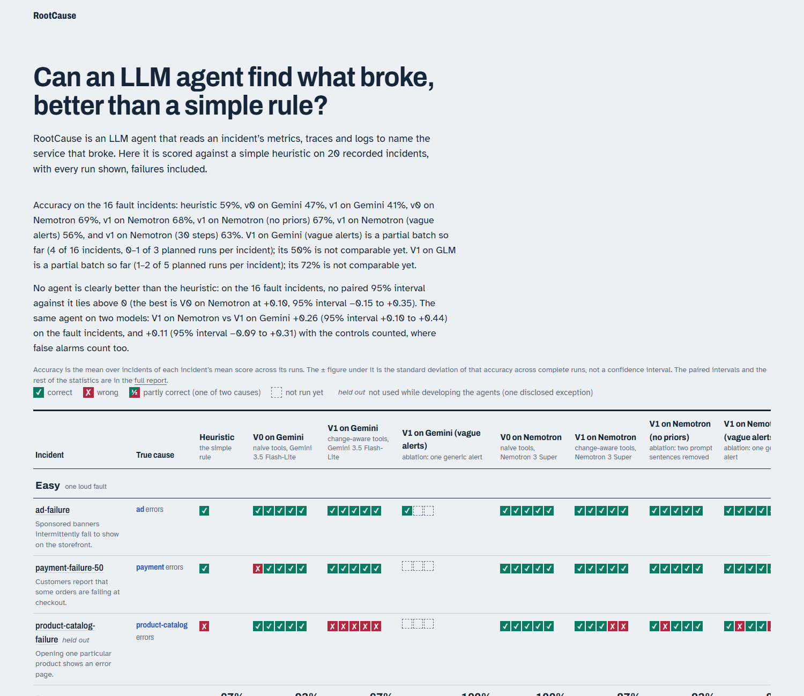
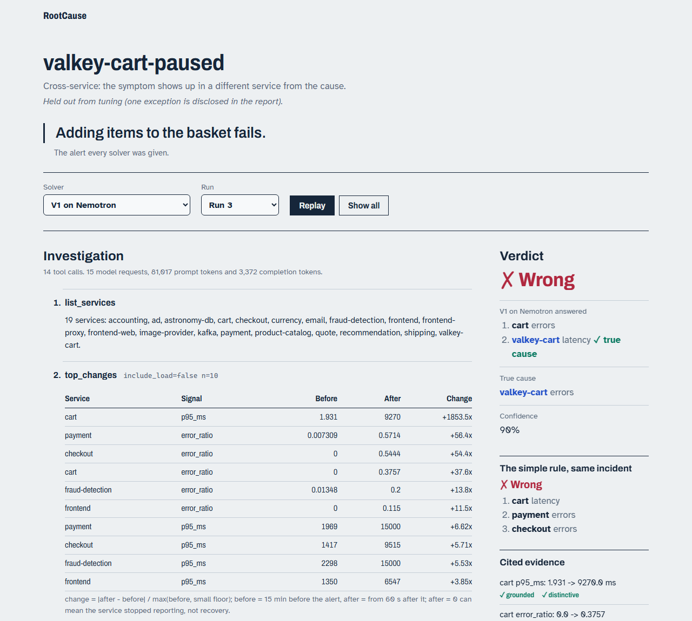

# RootCause

An LLM agent that investigates microservice incidents. Given a symptom ("customers report orders failing at checkout"), it queries OpenTelemetry metrics, traces and logs through tools and names the service and fault type behind it, citing evidence that is checked against the telemetry.

RootCause is mainly a **benchmark**: is an LLM agent actually better than a simple rule, and where? Every answer is scored against ground truth on 20 recorded incidents. The scoring rules were fixed before the first run, there are no-fault controls, the agent gets 5 runs per incident, and a held-out split is never used for tuning.

> Status: all five weeks are built. The agent batches are still running on the free tier's daily quota (about 40 runs a day), so agent results are partial until they finish. Results are in [`docs/results/`](docs/results/); they report failures as plainly as wins.

## How it works

```
 OpenTelemetry Demo (28 services, Docker)
   │  inject a fault (feature flag / docker pause / CPU cap) ─► wait ─► capture ─► restore
   ▼
 incident snapshot  (metrics series + sanitised traces + sanitised logs; ground truth stored separately)
   │
   ├─► heuristic baseline ── "which service's fault signal rose most?"
   └─► LLM agent (Gemini, free tier) ── tool loop: top_changes, service_map, search_traces, search_logs, ...
              │                                    (same tools also served over MCP)
              ▼
   report {verdict, ranked causes, evidence[], confidence}
              │
   score (fixed rules) + evidence check (do the cited metrics, traces and log lines exist?)
```

**1. Incident library.** There are 20 scenarios: 16 faults plus 4 no-fault controls, each injected once, live, into the [OpenTelemetry Demo](https://github.com/open-telemetry/opentelemetry-demo) and recorded as a self-contained snapshot. The fault categories are:
- **easy:** one loud fault;
- **cross-service:** the symptom shows up in a different service from the cause;
- **silent:** latency or resource faults with no errors;
- **noisy:** a real fault plus a decoy traffic flood;
- **two-fault:** both causes must be named.

Before a recording counts, metric checks confirm the fault really showed up. [`scenarios/NOTES.md`](scenarios/NOTES.md) records every outcome, including the scenarios that were dropped and why.

**2. Leak-proofing.** Faults are injected through the demo's feature flags, and the demo's own telemetry repeatedly names them: flag evaluation events, the flag service's traces, flag names in log lines, an attribute whose value is `true` only during one fault, Envoy's `DI` ("delay injected") marker, timing quirks in metadata, and alert wording. Each channel was found, closed, and is now caught by an automated leak scan. All of them are listed in `scenarios/NOTES.md`. The snapshots an agent sees contain no scenario names, no flag vocabulary and no ground truth.

**3. Solvers.**
- **Heuristic:** ranks every service's error ratio, p95 latency, peak memory, CPU and restarts by how much each rose compared with a 15-minute baseline. It names the top one. Its threshold was fixed in advance.
- **Agent v0:** a Gemini tool loop with naive tools (raw metric series, trace and log search).
- **Agent v1:** the same loop with change-aware tools (`top_changes`, `service_health`, `service_map`) and structured, checkable evidence.

**4. Scoring.** The rules were written before any run (`rootcause/score.py`):
- top-ranked cause in the accepted set;
- partial credit on two-fault scenarios;
- `no_incident` is the only right answer on a control;
- abstaining counts as wrong.

The reports show accuracy, top-3, fault type, false alarms and abstentions per category, as a mean ± spread across runs. They also show two evidence measures:
- **grounded:** the cited metric, trace or log line exists in the incident window;
- **distinctive:** it also points at something anomalous.

## Replay site

A static site replays every recorded run, failures included:
- **The scoreboard** shows one mark per run, for every incident and solver.
- **Each incident page** steps through the agent's investigation: every tool call and what it returned, drawn as tables and sparklines. Next to it is the verdict against the true cause, the simple rule's answer for the same incident, and the cited evidence marked grounded or not.





*(Screenshots from the partial agent v0 batch.)*

```bash
python -m rootcause report && python -m rootcause site   # regenerate figures and site/data from data/runs
python -m http.server 8000 -d site                       # then open http://localhost:8000
```

The site is plain HTML, CSS and JS with no build step, and every URL is relative, so it can be served from any sub-path. To publish it on GitHub Pages, copy the built `site/` (including the generated, git-ignored `site/data/` and `site/figures/`) into a `gh-pages` branch:

```bash
git worktree add --orphan -b gh-pages ../rootcause-pages     # first time only (git 2.42+)
git -C ../rootcause-pages rm -rq --ignore-unmatch .            # drop files from the last publish
cp -r site/. ../rootcause-pages/ && touch ../rootcause-pages/.nojekyll
git -C ../rootcause-pages add -A && git -C ../rootcause-pages commit -m "Publish replay site" && git -C ../rootcause-pages push origin gh-pages
```

The site shows ground truth, so it is built after scoring and is never given to the agent or the MCP server.

## Quick start

Requirements: Windows, macOS or Linux, Python 3.11, Docker (about 4 GB RAM for the demo), and a free [Gemini API key](https://aistudio.google.com/) (agent runs only).

```bash
python -m venv .venv && .venv/Scripts/python -m pip install -r requirements.txt   # (bin/python on macOS/Linux)
.venv/Scripts/python -m pytest -q                                                   # offline test suite
```

**Score the solvers on the recorded snapshots.** Put the Gemini key in `.env` as `GEMINI_API_KEY=...`.

```bash
python -m rootcause eval heuristic
python -m rootcause eval agent-v1 --runs 5          # resumable; stops cleanly on the daily free-tier quota
python -m rootcause summary agent-v1 --split heldout
```

**Record new incidents** with the demo checked out under `vendor/opentelemetry-demo`:

```bash
python -m rootcause up && python -m rootcause record --all   # ~24 min per scenario (cool-down + fault + capture)
python -m rootcause leak-check
```

**Use the tools from any MCP client** (e.g. Claude Desktop). This serves one snapshot's v1 tools over stdio, with the incident's alert as the server instructions:

```bash
python -m rootcause mcp data/snapshots/incident__<stamp>
```

In a client config, use absolute paths, with the venv's python as `command` and `["-m", "rootcause.mcp_server", "<abs snapshot dir>"]` as `args`. Set `cwd` to the repository root. Don't point an interactive session at a held-out snapshot (`config.HELDOUT`), because that contaminates the held-out split.

## Repository layout

| Path | What |
|---|---|
| `rootcause/inject.py`, `harness.py`, `snapshot.py`, `env.py` | fault injection with guaranteed restore, cool-down, capture |
| `rootcause/sanitize.py` | leak filters and the leak scanner |
| `rootcause/scenarios.py`, `scenarios/*.yaml` | scenario definitions, validation rules, notes |
| `rootcause/score.py`, `evaluate.py` | report validation, scoring, resumable runs, per-category summaries |
| `rootcause/summary.py`, `heuristic.py` | baseline-vs-fault change table and the heuristic |
| `rootcause/tools.py`, `tools_v1.py`, `agent.py` | agent tools (v0, v1) and the Gemini tool loop |
| `rootcause/evidence.py`, `mcp_server.py` | evidence checker and MCP server |
| `rootcause/report.py`, `tracing.py` | results report and figures; optional OpenTelemetry GenAI spans of agent runs |
| `rootcause/site.py`, `site/` | data builder and static front end of the replay site |

## Honest limits

- **Twenty incidents from one demo app on one laptop.** This is a careful small benchmark, not a general claim.
- **Both solvers get the exact fault onset** (t=0 is the injection time), and several alerts hint at the culprit's functional area. The planned vague-alert ablation measures how much that helps.
- **Free-tier models only** (Gemini Flash-Lite), at temperature 0. The 5-run spread measures API nondeterminism, not sampling.
