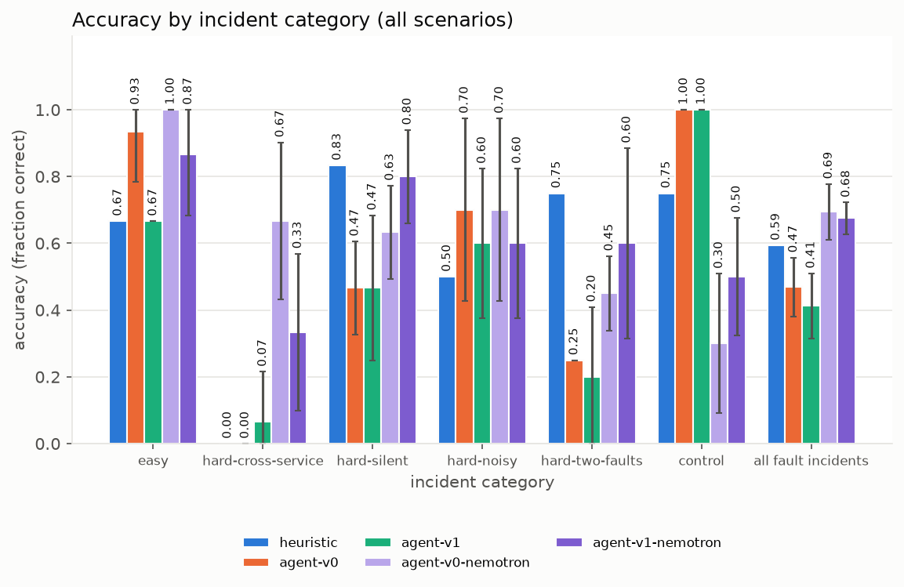
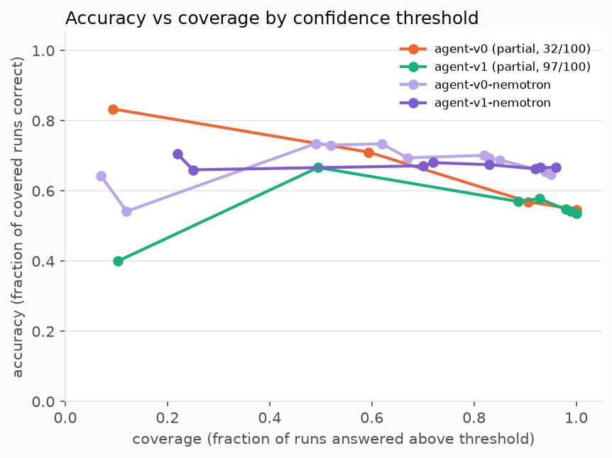

# RootCause evaluation report

## Accuracy by category

Accuracy is the mean over scenarios of each scenario's mean; ± is the sample sd across complete run indices (shown when at least two complete runs exist). The held-out split was frozen before any agent-v1 tuning. One held-out incident was viewed during agent-v1 development; see the disclosure under Provenance.

### Split: all

| category | heuristic | agent-v0 | agent-v1 | agent-v1-nopriors | agent-v1-vague | agent-v0-nemotron | agent-v1-nemotron | agent-v1-nemotron-nopriors | agent-v1-nemotron-vague | agent-v1-nemotron-steps30 | agent-v0@nvidia-nemotron-3.5-super-vl-120b-a12b | agent-v1@nvidia-nemotron-3.5-super-vl-120b-a12b | agent-v1@z-ai-glm-5.3-flash | hunch-0.6b | hunch-1.7b | laya-english | laya-multilingual |
|---|---|---|---|---|---|---|---|---|---|---|---|---|---|---|---|---|---|
| easy | 0.67 ± - (3/3 sc, 1 run) | 0.93 ± 0.15 (3/3 sc, 5 runs) | 0.67 ± 0.00 (3/3 sc, 5 runs) | 1.00 ± - (2/3 sc, 1 run) | 0.56 ± 0.19 (3/3 sc, 3 runs) | 1.00 ± 0.00 (3/3 sc, 5 runs) | 0.87 ± 0.18 (3/3 sc, 5 runs) | 0.93 ± 0.15 (3/3 sc, 5 runs) | 0.87 ± 0.18 (3/3 sc, 5 runs) | 0.87 ± 0.18 (3/3 sc, 5 runs) | 1.00 ± 0.00 (3/3 sc, 5 runs) | 1.00 ± 0.00 (3/3 sc, 5 runs) | 1.00 ± 0.00 (3/3 sc, 5 runs) | 0.00 ± - (3/3 sc, 1 run) | 0.00 ± - (3/3 sc, 1 run) | 0.00 ± - (3/3 sc, 1 run) | 0.33 ± - (3/3 sc, 1 run) |
| hard-cross-service | 0.00 ± - (3/3 sc, 1 run) | 0.00 ± 0.00 (3/3 sc, 5 runs) | 0.07 ± 0.15 (3/3 sc, 5 runs) | 0.00 ± - (2/3 sc, 1 run) | 0.00 ± 0.00 (3/3 sc, 3 runs) | 0.67 ± 0.24 (3/3 sc, 5 runs) | 0.33 ± 0.24 (3/3 sc, 5 runs) | 0.27 ± 0.15 (3/3 sc, 5 runs) | 0.27 ± 0.28 (3/3 sc, 5 runs) | 0.33 ± 0.24 (3/3 sc, 5 runs) | 0.87 ± 0.18 (3/3 sc, 5 runs) | 0.33 ± 0.24 (3/3 sc, 5 runs) | 0.60 ± 0.15 (3/3 sc, 5 runs) | 0.00 ± - (3/3 sc, 1 run) | 0.00 ± - (3/3 sc, 1 run) | 0.00 ± - (3/3 sc, 1 run) | 0.00 ± - (3/3 sc, 1 run) |
| hard-silent | 0.83 ± - (6/6 sc, 1 run) | 0.47 ± 0.14 (6/6 sc, 5 runs) | 0.47 ± 0.22 (6/6 sc, 5 runs) | 0.75 ± - (4/6 sc, 1 run) | 0.28 ± 0.10 (6/6 sc, 3 runs) | 0.63 ± 0.14 (6/6 sc, 5 runs) | 0.80 ± 0.14 (6/6 sc, 5 runs) | 0.73 ± 0.15 (6/6 sc, 5 runs) | 0.57 ± 0.09 (6/6 sc, 5 runs) | 0.63 ± 0.07 (6/6 sc, 5 runs) | 0.63 ± 0.14 (6/6 sc, 5 runs) | 0.80 ± 0.14 (6/6 sc, 5 runs) | 0.60 ± 0.15 (6/6 sc, 5 runs) | 0.00 ± - (6/6 sc, 1 run) | 0.00 ± - (6/6 sc, 1 run) | 0.33 ± - (6/6 sc, 1 run) | 0.50 ± - (6/6 sc, 1 run) |
| hard-noisy | 0.50 ± - (2/2 sc, 1 run) | 0.70 ± 0.27 (2/2 sc, 5 runs) | 0.60 ± 0.22 (2/2 sc, 5 runs) | 1.00 ± - (2/2 sc, 1 run) | 0.50 ± 0.00 (2/2 sc, 3 runs) | 0.70 ± 0.27 (2/2 sc, 5 runs) | 0.60 ± 0.22 (2/2 sc, 5 runs) | 0.60 ± 0.22 (2/2 sc, 5 runs) | 0.60 ± 0.22 (2/2 sc, 5 runs) | 0.50 ± 0.00 (2/2 sc, 5 runs) | 0.70 ± 0.27 (2/2 sc, 5 runs) | 0.70 ± 0.27 (2/2 sc, 5 runs) | 0.70 ± 0.27 (2/2 sc, 5 runs) | 0.00 ± - (2/2 sc, 1 run) | 0.00 ± - (2/2 sc, 1 run) | 0.50 ± - (2/2 sc, 1 run) | 0.50 ± - (2/2 sc, 1 run) |
| hard-two-faults | 0.75 ± - (2/2 sc, 1 run) | 0.25 ± 0.00 (2/2 sc, 5 runs) | 0.20 ± 0.21 (2/2 sc, 5 runs) | 0.50 ± - (2/2 sc, 1 run) | 0.08 ± 0.14 (2/2 sc, 3 runs) | 0.45 ± 0.11 (2/2 sc, 5 runs) | 0.60 ± 0.29 (2/2 sc, 5 runs) | 0.75 ± 0.18 (2/2 sc, 5 runs) | 0.45 ± 0.11 (2/2 sc, 5 runs) | 0.85 ± 0.22 (2/2 sc, 5 runs) | 0.45 ± 0.11 (2/2 sc, 5 runs) | 0.75 ± 0.18 (2/2 sc, 5 runs) | 0.95 ± 0.11 (2/2 sc, 5 runs) | 0.00 ± - (2/2 sc, 1 run) | 0.00 ± - (2/2 sc, 1 run) | 0.00 ± - (2/2 sc, 1 run) | 0.00 ± - (2/2 sc, 1 run) |
| control | 0.75 ± - (4/4 sc, 1 run) | 1.00 ± 0.00 (4/4 sc, 5 runs) | 1.00 ± 0.00 (4/4 sc, 5 runs) | 0.75 ± - (4/4 sc, 1 run) | 0.75 ± 0.00 (4/4 sc, 3 runs) | 0.30 ± 0.21 (4/4 sc, 5 runs) | 0.50 ± 0.18 (4/4 sc, 5 runs) | 0.50 ± 0.18 (4/4 sc, 5 runs) | 0.25 ± 0.18 (4/4 sc, 5 runs) | 0.55 ± 0.21 (4/4 sc, 5 runs) | 0.60 ± 0.22 (4/4 sc, 5 runs) | 0.65 ± 0.14 (4/4 sc, 5 runs) | 0.80 ± 0.11 (4/4 sc, 5 runs) | 1.00 ± - (4/4 sc, 1 run) | 1.00 ± - (4/4 sc, 1 run) | 0.00 ± - (4/4 sc, 1 run) | 0.50 ± - (4/4 sc, 1 run) |
| all fault incidents | 0.59 ± - (16/16 sc, 1 run) | 0.47 ± 0.09 (16/16 sc, 5 runs) | 0.41 ± 0.10 (16/16 sc, 5 runs) | 0.67 ± - (12/16 sc, 1 run) | 0.28 ± 0.03 (16/16 sc, 3 runs) | 0.69 ± 0.08 (16/16 sc, 5 runs) | 0.68 ± 0.05 (16/16 sc, 5 runs) | 0.67 ± 0.06 (16/16 sc, 5 runs) | 0.56 ± 0.13 (16/16 sc, 5 runs) | 0.63 ± 0.08 (16/16 sc, 5 runs) | 0.73 ± 0.09 (16/16 sc, 5 runs) | 0.73 ± 0.08 (16/16 sc, 5 runs) | 0.73 ± 0.06 (16/16 sc, 5 runs) | 0.00 ± - (16/16 sc, 1 run) | 0.00 ± - (16/16 sc, 1 run) | 0.19 ± - (16/16 sc, 1 run) | 0.31 ± - (16/16 sc, 1 run) |

agent-v1-nopriors: partial batch (0-1 runs per scenario, 16/60 runs)

### Split: tune

| category | heuristic | agent-v0 | agent-v1 | agent-v1-nopriors | agent-v1-vague | agent-v0-nemotron | agent-v1-nemotron | agent-v1-nemotron-nopriors | agent-v1-nemotron-vague | agent-v1-nemotron-steps30 | agent-v0@nvidia-nemotron-3.5-super-vl-120b-a12b | agent-v1@nvidia-nemotron-3.5-super-vl-120b-a12b | agent-v1@z-ai-glm-5.3-flash | hunch-0.6b | hunch-1.7b | laya-english | laya-multilingual |
|---|---|---|---|---|---|---|---|---|---|---|---|---|---|---|---|---|---|
| easy | 1.00 ± - (2/2 sc, 1 run) | 0.90 ± 0.22 (2/2 sc, 5 runs) | 1.00 ± 0.00 (2/2 sc, 5 runs) | 1.00 ± - (2/2 sc, 1 run) | 0.83 ± 0.29 (2/2 sc, 3 runs) | 1.00 ± 0.00 (2/2 sc, 5 runs) | 1.00 ± 0.00 (2/2 sc, 5 runs) | 1.00 ± 0.00 (2/2 sc, 5 runs) | 1.00 ± 0.00 (2/2 sc, 5 runs) | 1.00 ± 0.00 (2/2 sc, 5 runs) | 1.00 ± 0.00 (2/2 sc, 5 runs) | 1.00 ± 0.00 (2/2 sc, 5 runs) | 1.00 ± 0.00 (2/2 sc, 5 runs) | 0.00 ± - (2/2 sc, 1 run) | 0.00 ± - (2/2 sc, 1 run) | 0.00 ± - (2/2 sc, 1 run) | 0.00 ± - (2/2 sc, 1 run) |
| hard-cross-service | 0.00 ± - (2/2 sc, 1 run) | 0.00 ± 0.00 (2/2 sc, 5 runs) | 0.00 ± 0.00 (2/2 sc, 5 runs) | 0.00 ± - (2/2 sc, 1 run) | 0.00 ± 0.00 (2/2 sc, 3 runs) | 0.60 ± 0.22 (2/2 sc, 5 runs) | 0.30 ± 0.27 (2/2 sc, 5 runs) | 0.30 ± 0.27 (2/2 sc, 5 runs) | 0.20 ± 0.27 (2/2 sc, 5 runs) | 0.20 ± 0.27 (2/2 sc, 5 runs) | 0.90 ± 0.22 (2/2 sc, 5 runs) | 0.40 ± 0.22 (2/2 sc, 5 runs) | 0.40 ± 0.22 (2/2 sc, 5 runs) | 0.00 ± - (2/2 sc, 1 run) | 0.00 ± - (2/2 sc, 1 run) | 0.00 ± - (2/2 sc, 1 run) | 0.00 ± - (2/2 sc, 1 run) |
| hard-silent | 0.80 ± - (5/5 sc, 1 run) | 0.52 ± 0.18 (5/5 sc, 5 runs) | 0.56 ± 0.26 (5/5 sc, 5 runs) | 0.75 ± - (4/5 sc, 1 run) | 0.27 ± 0.12 (5/5 sc, 3 runs) | 0.60 ± 0.20 (5/5 sc, 5 runs) | 0.76 ± 0.17 (5/5 sc, 5 runs) | 0.68 ± 0.18 (5/5 sc, 5 runs) | 0.48 ± 0.11 (5/5 sc, 5 runs) | 0.68 ± 0.11 (5/5 sc, 5 runs) | 0.68 ± 0.11 (5/5 sc, 5 runs) | 0.76 ± 0.17 (5/5 sc, 5 runs) | 0.52 ± 0.18 (5/5 sc, 5 runs) | 0.00 ± - (5/5 sc, 1 run) | 0.00 ± - (5/5 sc, 1 run) | 0.40 ± - (5/5 sc, 1 run) | 0.40 ± - (5/5 sc, 1 run) |
| hard-noisy | 0.00 ± - (1/1 sc, 1 run) | 0.60 ± 0.55 (1/1 sc, 5 runs) | 0.20 ± 0.45 (1/1 sc, 5 runs) | 1.00 ± - (1/1 sc, 1 run) | 0.00 ± 0.00 (1/1 sc, 3 runs) | 0.40 ± 0.55 (1/1 sc, 5 runs) | 0.20 ± 0.45 (1/1 sc, 5 runs) | 0.40 ± 0.55 (1/1 sc, 5 runs) | 0.20 ± 0.45 (1/1 sc, 5 runs) | 0.00 ± 0.00 (1/1 sc, 5 runs) | 0.40 ± 0.55 (1/1 sc, 5 runs) | 0.40 ± 0.55 (1/1 sc, 5 runs) | 0.40 ± 0.55 (1/1 sc, 5 runs) | 0.00 ± - (1/1 sc, 1 run) | 0.00 ± - (1/1 sc, 1 run) | 0.00 ± - (1/1 sc, 1 run) | 1.00 ± - (1/1 sc, 1 run) |
| hard-two-faults | 0.50 ± - (1/1 sc, 1 run) | 0.00 ± 0.00 (1/1 sc, 5 runs) | 0.10 ± 0.22 (1/1 sc, 5 runs) | 0.00 ± - (1/1 sc, 1 run) | 0.00 ± 0.00 (1/1 sc, 3 runs) | 0.40 ± 0.22 (1/1 sc, 5 runs) | 0.50 ± 0.35 (1/1 sc, 5 runs) | 0.60 ± 0.22 (1/1 sc, 5 runs) | 0.40 ± 0.22 (1/1 sc, 5 runs) | 0.80 ± 0.27 (1/1 sc, 5 runs) | 0.40 ± 0.22 (1/1 sc, 5 runs) | 0.70 ± 0.27 (1/1 sc, 5 runs) | 0.90 ± 0.22 (1/1 sc, 5 runs) | 0.00 ± - (1/1 sc, 1 run) | 0.00 ± - (1/1 sc, 1 run) | 0.00 ± - (1/1 sc, 1 run) | 0.00 ± - (1/1 sc, 1 run) |
| control | 0.67 ± - (3/3 sc, 1 run) | 1.00 ± 0.00 (3/3 sc, 5 runs) | 1.00 ± 0.00 (3/3 sc, 5 runs) | 0.67 ± - (3/3 sc, 1 run) | 0.67 ± 0.00 (3/3 sc, 3 runs) | 0.33 ± 0.24 (3/3 sc, 5 runs) | 0.53 ± 0.18 (3/3 sc, 5 runs) | 0.40 ± 0.15 (3/3 sc, 5 runs) | 0.27 ± 0.15 (3/3 sc, 5 runs) | 0.40 ± 0.28 (3/3 sc, 5 runs) | 0.47 ± 0.30 (3/3 sc, 5 runs) | 0.53 ± 0.18 (3/3 sc, 5 runs) | 0.73 ± 0.15 (3/3 sc, 5 runs) | 1.00 ± - (3/3 sc, 1 run) | 1.00 ± - (3/3 sc, 1 run) | 0.00 ± - (3/3 sc, 1 run) | 0.67 ± - (3/3 sc, 1 run) |
| all fault incidents | 0.59 ± - (11/11 sc, 1 run) | 0.45 ± 0.11 (11/11 sc, 5 runs) | 0.46 ± 0.11 (11/11 sc, 5 runs) | 0.60 ± - (10/11 sc, 1 run) | 0.27 ± 0.09 (11/11 sc, 3 runs) | 0.64 ± 0.09 (11/11 sc, 5 runs) | 0.65 ± 0.06 (11/11 sc, 5 runs) | 0.64 ± 0.09 (11/11 sc, 5 runs) | 0.49 ± 0.12 (11/11 sc, 5 runs) | 0.60 ± 0.06 (11/11 sc, 5 runs) | 0.73 ± 0.11 (11/11 sc, 5 runs) | 0.70 ± 0.09 (11/11 sc, 5 runs) | 0.61 ± 0.09 (11/11 sc, 5 runs) | 0.00 ± - (11/11 sc, 1 run) | 0.00 ± - (11/11 sc, 1 run) | 0.18 ± - (11/11 sc, 1 run) | 0.27 ± - (11/11 sc, 1 run) |

agent-v1-nopriors: partial batch (0-1 runs per scenario, 13/42 runs)

### Split: heldout

| category | heuristic | agent-v0 | agent-v1 | agent-v1-nopriors | agent-v1-vague | agent-v0-nemotron | agent-v1-nemotron | agent-v1-nemotron-nopriors | agent-v1-nemotron-vague | agent-v1-nemotron-steps30 | agent-v0@nvidia-nemotron-3.5-super-vl-120b-a12b | agent-v1@nvidia-nemotron-3.5-super-vl-120b-a12b | agent-v1@z-ai-glm-5.3-flash | hunch-0.6b | hunch-1.7b | laya-english | laya-multilingual |
|---|---|---|---|---|---|---|---|---|---|---|---|---|---|---|---|---|---|
| easy | 0.00 ± - (1/1 sc, 1 run) | 1.00 ± 0.00 (1/1 sc, 5 runs) | 0.00 ± 0.00 (1/1 sc, 5 runs) | - | 0.00 ± 0.00 (1/1 sc, 3 runs) | 1.00 ± 0.00 (1/1 sc, 5 runs) | 0.60 ± 0.55 (1/1 sc, 5 runs) | 0.80 ± 0.45 (1/1 sc, 5 runs) | 0.60 ± 0.55 (1/1 sc, 5 runs) | 0.60 ± 0.55 (1/1 sc, 5 runs) | 1.00 ± 0.00 (1/1 sc, 5 runs) | 1.00 ± 0.00 (1/1 sc, 5 runs) | 1.00 ± 0.00 (1/1 sc, 5 runs) | 0.00 ± - (1/1 sc, 1 run) | 0.00 ± - (1/1 sc, 1 run) | 0.00 ± - (1/1 sc, 1 run) | 1.00 ± - (1/1 sc, 1 run) |
| hard-cross-service | 0.00 ± - (1/1 sc, 1 run) | 0.00 ± 0.00 (1/1 sc, 5 runs) | 0.20 ± 0.45 (1/1 sc, 5 runs) | - | 0.00 ± 0.00 (1/1 sc, 3 runs) | 0.80 ± 0.45 (1/1 sc, 5 runs) | 0.40 ± 0.55 (1/1 sc, 5 runs) | 0.20 ± 0.45 (1/1 sc, 5 runs) | 0.40 ± 0.55 (1/1 sc, 5 runs) | 0.60 ± 0.55 (1/1 sc, 5 runs) | 0.80 ± 0.45 (1/1 sc, 5 runs) | 0.20 ± 0.45 (1/1 sc, 5 runs) | 1.00 ± 0.00 (1/1 sc, 5 runs) | 0.00 ± - (1/1 sc, 1 run) | 0.00 ± - (1/1 sc, 1 run) | 0.00 ± - (1/1 sc, 1 run) | 0.00 ± - (1/1 sc, 1 run) |
| hard-silent | 1.00 ± - (1/1 sc, 1 run) | 0.20 ± 0.45 (1/1 sc, 5 runs) | 0.00 ± 0.00 (1/1 sc, 5 runs) | - | 0.33 ± 0.58 (1/1 sc, 3 runs) | 0.80 ± 0.45 (1/1 sc, 5 runs) | 1.00 ± 0.00 (1/1 sc, 5 runs) | 1.00 ± 0.00 (1/1 sc, 5 runs) | 1.00 ± 0.00 (1/1 sc, 5 runs) | 0.40 ± 0.55 (1/1 sc, 5 runs) | 0.40 ± 0.55 (1/1 sc, 5 runs) | 1.00 ± 0.00 (1/1 sc, 5 runs) | 1.00 ± 0.00 (1/1 sc, 5 runs) | 0.00 ± - (1/1 sc, 1 run) | 0.00 ± - (1/1 sc, 1 run) | 0.00 ± - (1/1 sc, 1 run) | 1.00 ± - (1/1 sc, 1 run) |
| hard-noisy | 1.00 ± - (1/1 sc, 1 run) | 0.80 ± 0.45 (1/1 sc, 5 runs) | 1.00 ± 0.00 (1/1 sc, 5 runs) | 1.00 ± - (1/1 sc, 1 run) | 1.00 ± 0.00 (1/1 sc, 3 runs) | 1.00 ± 0.00 (1/1 sc, 5 runs) | 1.00 ± 0.00 (1/1 sc, 5 runs) | 0.80 ± 0.45 (1/1 sc, 5 runs) | 1.00 ± 0.00 (1/1 sc, 5 runs) | 1.00 ± 0.00 (1/1 sc, 5 runs) | 1.00 ± 0.00 (1/1 sc, 5 runs) | 1.00 ± 0.00 (1/1 sc, 5 runs) | 1.00 ± 0.00 (1/1 sc, 5 runs) | 0.00 ± - (1/1 sc, 1 run) | 0.00 ± - (1/1 sc, 1 run) | 1.00 ± - (1/1 sc, 1 run) | 0.00 ± - (1/1 sc, 1 run) |
| hard-two-faults | 1.00 ± - (1/1 sc, 1 run) | 0.50 ± 0.00 (1/1 sc, 5 runs) | 0.30 ± 0.27 (1/1 sc, 5 runs) | 1.00 ± - (1/1 sc, 1 run) | 0.17 ± 0.29 (1/1 sc, 3 runs) | 0.50 ± 0.00 (1/1 sc, 5 runs) | 0.70 ± 0.27 (1/1 sc, 5 runs) | 0.90 ± 0.22 (1/1 sc, 5 runs) | 0.50 ± 0.00 (1/1 sc, 5 runs) | 0.90 ± 0.22 (1/1 sc, 5 runs) | 0.50 ± 0.00 (1/1 sc, 5 runs) | 0.80 ± 0.27 (1/1 sc, 5 runs) | 1.00 ± 0.00 (1/1 sc, 5 runs) | 0.00 ± - (1/1 sc, 1 run) | 0.00 ± - (1/1 sc, 1 run) | 0.00 ± - (1/1 sc, 1 run) | 0.00 ± - (1/1 sc, 1 run) |
| control | 1.00 ± - (1/1 sc, 1 run) | 1.00 ± 0.00 (1/1 sc, 5 runs) | 1.00 ± 0.00 (1/1 sc, 5 runs) | 1.00 ± - (1/1 sc, 1 run) | 1.00 ± 0.00 (1/1 sc, 3 runs) | 0.20 ± 0.45 (1/1 sc, 5 runs) | 0.40 ± 0.55 (1/1 sc, 5 runs) | 0.80 ± 0.45 (1/1 sc, 5 runs) | 0.20 ± 0.45 (1/1 sc, 5 runs) | 1.00 ± 0.00 (1/1 sc, 5 runs) | 1.00 ± 0.00 (1/1 sc, 5 runs) | 1.00 ± 0.00 (1/1 sc, 5 runs) | 1.00 ± 0.00 (1/1 sc, 5 runs) | 1.00 ± - (1/1 sc, 1 run) | 1.00 ± - (1/1 sc, 1 run) | 0.00 ± - (1/1 sc, 1 run) | 0.00 ± - (1/1 sc, 1 run) |
| all fault incidents | 0.60 ± - (5/5 sc, 1 run) | 0.50 ± 0.14 (5/5 sc, 5 runs) | 0.30 ± 0.07 (5/5 sc, 5 runs) | 1.00 ± - (2/5 sc, 1 run) | 0.30 ± 0.17 (5/5 sc, 3 runs) | 0.82 ± 0.11 (5/5 sc, 5 runs) | 0.74 ± 0.15 (5/5 sc, 5 runs) | 0.74 ± 0.17 (5/5 sc, 5 runs) | 0.70 ± 0.20 (5/5 sc, 5 runs) | 0.70 ± 0.26 (5/5 sc, 5 runs) | 0.74 ± 0.09 (5/5 sc, 5 runs) | 0.80 ± 0.12 (5/5 sc, 5 runs) | 1.00 ± 0.00 (5/5 sc, 5 runs) | 0.00 ± - (5/5 sc, 1 run) | 0.00 ± - (5/5 sc, 1 run) | 0.20 ± - (5/5 sc, 1 run) | 0.40 ± - (5/5 sc, 1 run) |

agent-v1-nopriors: partial batch (0-1 runs per scenario, 3/18 runs)

Held-out categories have one scenario each; read the all-fault-incidents row.

Bars: accuracy over all scenarios; error bars ± sample sd across complete run indices, clipped to 0-1 (none when fewer than two complete runs). A solver with no record in a category has no bar there.

## False alarms and abstentions (all split)

False alarm = claiming an incident on a control; abstain = insufficient evidence on an incident.

| solver | control false-alarm rate | incident abstain rate |
|---|---|---|
| heuristic | 0.25 | 0.00 |
| agent-v0 | 0.00 | 0.00 |
| agent-v1 | 0.00 | 0.00 |
| agent-v1-nopriors | 0.25 | 0.00 |
| agent-v1-vague | 0.25 | 0.00 |
| agent-v0-nemotron | 0.60 | 0.04 |
| agent-v1-nemotron | 0.35 | 0.01 |
| agent-v1-nemotron-nopriors | 0.35 | 0.03 |
| agent-v1-nemotron-vague | 0.70 | 0.06 |
| agent-v1-nemotron-steps30 | 0.40 | 0.00 |
| agent-v0@nvidia-nemotron-3.5-super-vl-120b-a12b | 0.40 | 0.00 |
| agent-v1@nvidia-nemotron-3.5-super-vl-120b-a12b | 0.35 | 0.00 |
| agent-v1@z-ai-glm-5.3-flash | 0.20 | 0.00 |
| hunch-0.6b | 0.00 | 0.00 |
| hunch-1.7b | 0.00 | 0.00 |
| laya-english | 1.00 | 0.00 |
| laya-multilingual | 0.50 | 0.00 |

## Evidence (all split, incidents)

Grounded = cited evidence exists in the snapshot; distinctive = it also looks anomalous against the baseline (neither proves that the incident caused it). The heuristic cites rows of the same change table this check reads, so its 1.00 is by construction.

| solver | grounded | distinctive |
|---|---|---|
| heuristic | 1.00 | 1.00 |
| agent-v0 | n/a (free-text evidence) | n/a (free-text evidence) |
| agent-v1 | 1.00 | 0.83 |
| agent-v1-nopriors | 0.94 | 0.88 |
| agent-v1-vague | 1.00 | 0.91 |
| agent-v0-nemotron | n/a (free-text evidence) | n/a (free-text evidence) |
| agent-v1-nemotron | 0.98 | 0.89 |
| agent-v1-nemotron-nopriors | 0.94 | 0.85 |
| agent-v1-nemotron-vague | 0.97 | 0.90 |
| agent-v1-nemotron-steps30 | 0.93 | 0.83 |
| agent-v0@nvidia-nemotron-3.5-super-vl-120b-a12b | n/a (free-text evidence) | n/a (free-text evidence) |
| agent-v1@nvidia-nemotron-3.5-super-vl-120b-a12b | 0.90 | 0.77 |
| agent-v1@z-ai-glm-5.3-flash | 0.94 | 0.73 |
| hunch-0.6b | - | - |
| hunch-1.7b | - | - |
| laya-english | - | - |
| laya-multilingual | - | - |

## Paired comparisons (all split, fault incidents; the last three columns add the controls)

Each solver's mean score per incident, compared on the incidents both have run. Wins / ties / losses count incidents where the first solver scored higher / the same / lower, by any margin. A per-incident mean of 0.5 can mean one of two causes found or half of the runs right. The 95% interval is a percentile bootstrap over incidents (10,000 resamples, fixed seed); at this few incidents it is approximate and somewhat too narrow, and it is not given below 5 shared incidents. An interval that includes 0 means this benchmark cannot tell the two apart. p is an exact paired permutation test on the fault incidents (every sign flip of the per-incident differences), which does not share the bootstrap's narrowness. About twenty comparisons are shown with no multiple-comparison correction; an interval that only just excludes 0 is suggestive, not established. Fault-only differences ignore false alarms on the 4 controls; the last three columns include them, over the incidents both solvers have run.

| comparison | incidents | wins / ties / losses | mean difference | 95% interval | p (permutation) | incidents (controls incl.) | mean difference (controls incl.) | 95% interval (controls incl.) |
|---|---|---|---|---|---|---|---|---|
| agent-v0 vs heuristic | 16/16 | 3 / 5 / 8 | -0.12 | -0.39 to +0.17 | 0.44 | 20/20 | -0.05 | -0.29 to +0.20 |
| agent-v1 vs heuristic | 16/16 | 3 / 7 / 6 | -0.18 | -0.40 to +0.02 | 0.15 | 20/20 | -0.10 | -0.30 to +0.11 |
| agent-v1 vs agent-v0 | 16/16 | 5 / 6 / 5 | -0.06 | -0.23 to +0.10 | 0.60 | 20/20 | -0.05 | -0.18 to +0.08 |
| agent-v1-nopriors vs agent-v1 | 12/16 | 4 / 6 / 2 | +0.18 | -0.03 to +0.42 | 0.19 | 16/20 | +0.07 | -0.14 to +0.30 |
| agent-v1-vague vs agent-v1 | 16/16 | 1 / 7 / 8 | -0.13 | -0.27 to -0.01 | 0.07 | 20/20 | -0.16 | -0.29 to -0.03 |
| agent-v0-nemotron vs heuristic | 16/16 | 6 / 4 / 6 | +0.10 | -0.15 to +0.35 | 0.49 | 20/20 | -0.01 | -0.24 to +0.23 |
| agent-v1-nemotron vs heuristic | 16/16 | 5 / 8 / 3 | +0.08 | -0.05 to +0.23 | 0.31 | 20/20 | +0.01 | -0.11 to +0.15 |
| agent-v1-nemotron vs agent-v1 | 16/16 | 9 / 5 / 2 | +0.26 | +0.10 to +0.44 | 0.01 | 20/20 | +0.11 | -0.09 to +0.31 |
| agent-v0-nemotron vs agent-v0 | 16/16 | 9 / 4 / 3 | +0.23 | +0.04 to +0.41 | 0.05 | 20/20 | +0.04 | -0.19 to +0.26 |
| agent-v1-nemotron vs agent-v0-nemotron | 16/16 | 6 / 4 / 6 | -0.02 | -0.14 to +0.11 | 0.86 | 20/20 | +0.03 | -0.09 to +0.14 |
| agent-v1-nemotron-nopriors vs agent-v1-nemotron | 16/16 | 4 / 8 / 4 | -0.01 | -0.07 to +0.06 | 1.00 | 20/20 | -0.00 | -0.07 to +0.07 |
| agent-v1-nemotron-vague vs agent-v1-nemotron | 16/16 | 1 / 9 / 6 | -0.12 | -0.25 to -0.01 | 0.09 | 20/20 | -0.15 | -0.26 to -0.05 |
| agent-v1-nemotron-steps30 vs agent-v1-nemotron | 16/16 | 4 / 7 / 5 | -0.04 | -0.16 to +0.06 | 0.53 | 20/20 | -0.03 | -0.14 to +0.09 |
| agent-v1@nvidia-nemotron-3.5-super-vl-120b-a12b vs heuristic | 16/16 | 6 / 7 / 3 | +0.14 | -0.02 to +0.33 | 0.21 | 20/20 | +0.09 | -0.05 to +0.25 |
| agent-v0@nvidia-nemotron-3.5-super-vl-120b-a12b vs heuristic | 16/16 | 6 / 6 / 4 | +0.14 | -0.13 to +0.41 | 0.37 | 20/20 | +0.08 | -0.16 to +0.32 |
| agent-v1@nvidia-nemotron-3.5-super-vl-120b-a12b vs agent-v1-nemotron | 16/16 | 5 / 10 / 1 | +0.06 | -0.01 to +0.12 | 0.19 | 20/20 | +0.07 | -0.00 to +0.16 |
| agent-v0@nvidia-nemotron-3.5-super-vl-120b-a12b vs agent-v0-nemotron | 16/16 | 4 / 10 / 2 | +0.04 | -0.05 to +0.12 | 0.62 | 20/20 | +0.09 | -0.02 to +0.21 |
| agent-v1@nvidia-nemotron-3.5-super-vl-120b-a12b vs agent-v0@nvidia-nemotron-3.5-super-vl-120b-a12b | 16/16 | 4 / 8 / 4 | -0.00 | -0.17 to +0.17 | 1.00 | 20/20 | +0.01 | -0.14 to +0.15 |
| agent-v1@z-ai-glm-5.3-flash vs heuristic | 16/16 | 5 / 9 / 2 | +0.14 | -0.09 to +0.38 | 0.34 | 20/20 | +0.12 | -0.09 to +0.33 |
| agent-v1@z-ai-glm-5.3-flash vs agent-v1 | 16/16 | 9 / 5 / 2 | +0.32 | +0.09 to +0.56 | 0.03 | 20/20 | +0.21 | +0.00 to +0.43 |

agent-v1-nopriors: partial batch (0-1 runs per scenario, 16/60 runs)

## Failure modes (all split, wrong fault-incident runs)

How each wrong run on a fault incident went wrong. The top-changed service is the one with the largest rise in the incident's change table, usually where the symptom shows; naming it is the heuristic's whole method. Each wrong run is counted once, in the first matching column, left to right.

| solver | wrong runs | said no incident | abstained | found one of two causes | true cause ranked 2nd or 3rd | named the top-changed service | another wrong service |
|---|---|---|---|---|---|---|---|
| heuristic | 7 | 0 | 0 | 1 | 3 | 3 | 0 |
| agent-v0 | 45 | 26 | 0 | 5 | 7 | 7 | 0 |
| agent-v1 | 49 | 34 | 0 | 4 | 2 | 9 | 0 |
| agent-v1-nopriors | 4 | 2 | 0 | 0 | 0 | 2 | 0 |
| agent-v1-vague | 35 | 23 | 0 | 1 | 2 | 8 | 1 |
| agent-v0-nemotron | 29 | 0 | 3 | 9 | 2 | 5 | 10 |
| agent-v1-nemotron | 29 | 2 | 1 | 6 | 10 | 8 | 2 |
| agent-v1-nemotron-nopriors | 29 | 0 | 2 | 5 | 13 | 7 | 2 |
| agent-v1-nemotron-vague | 40 | 3 | 5 | 9 | 5 | 12 | 6 |
| agent-v1-nemotron-steps30 | 31 | 2 | 0 | 3 | 8 | 11 | 7 |
| agent-v0@nvidia-nemotron-3.5-super-vl-120b-a12b | 26 | 3 | 0 | 9 | 4 | 2 | 8 |
| agent-v1@nvidia-nemotron-3.5-super-vl-120b-a12b | 24 | 2 | 0 | 5 | 6 | 10 | 1 |
| agent-v1@z-ai-glm-5.3-flash | 22 | 5 | 0 | 1 | 8 | 5 | 3 |
| hunch-0.6b | 16 | 16 | 0 | 0 | 0 | 0 | 0 |
| hunch-1.7b | 16 | 16 | 0 | 0 | 0 | 0 | 0 |
| laya-english | 13 | 0 | 0 | 0 | 5 | 4 | 4 |
| laya-multilingual | 11 | 10 | 0 | 0 | 1 | 0 | 0 |

## Step limit (all split, fault runs)

An agent still calling tools when it reaches its step limit (15 model turns; 30 for the 30-step ablation) is told to give its final answer. This splits each agent's fault runs by whether that happened: how many hit the limit, how many of those then answered "no incident", and the accuracy (mean over runs, not per scenario) with and without hitting it.

| solver | fault runs | hit the limit | then said no incident | accuracy when hit | accuracy otherwise |
|---|---|---|---|---|---|
| agent-v0 | 80 | 19 (24%) | 5 of 19 | 0.53 | 0.45 |
| agent-v1 | 80 | 49 (61%) | 27 of 49 | 0.29 | 0.61 |
| agent-v1-nopriors | 12 | 5 (42%) | 1 of 5 | 0.60 | 0.71 |
| agent-v1-vague | 48 | 30 (62%) | 17 of 30 | 0.25 | 0.33 |
| agent-v0-nemotron | 80 | 75 (94%) | 0 of 75 | 0.69 | 0.80 |
| agent-v1-nemotron | 80 | 54 (68%) | 2 of 54 | 0.63 | 0.77 |
| agent-v1-nemotron-nopriors | 80 | 49 (61%) | 0 of 49 | 0.63 | 0.73 |
| agent-v1-nemotron-vague | 80 | 62 (78%) | 3 of 62 | 0.49 | 0.78 |
| agent-v1-nemotron-steps30 | 80 | 12 (15%) | 0 of 12 | 0.46 | 0.66 |
| agent-v0@nvidia-nemotron-3.5-super-vl-120b-a12b | 80 | 21 (26%) | 3 of 21 | 0.69 | 0.75 |
| agent-v1@nvidia-nemotron-3.5-super-vl-120b-a12b | 80 | 8 (10%) | 0 of 8 | 0.56 | 0.75 |
| agent-v1@z-ai-glm-5.3-flash | 80 | 7 (9%) | 0 of 7 | 0.57 | 0.75 |

## Run-to-run agreement (all scenarios, controls included)

The built-in agents run at temperature 0, yet their runs still differ, so this measures how far a single run can be trusted. A run's top answer is its first cause's service, or its verdict when it names no cause. Pairwise agreement is the share of run pairs on a scenario that give the same top answer, averaged over the scenarios with at least 2 runs; controls included. With fewer runs per scenario every run agrees more easily, so compare complete batches only.

| solver | scenarios with 2+ runs | every run agrees | pairwise agreement |
|---|---|---|---|
| agent-v0 | 20 | 12 of 20 | 0.81 |
| agent-v1 | 20 | 12 of 20 | 0.80 |
| agent-v1-vague | 20 | 13 of 20 | 0.75 |
| agent-v0-nemotron | 20 | 6 of 20 | 0.54 |
| agent-v1-nemotron | 20 | 8 of 20 | 0.66 |
| agent-v1-nemotron-nopriors | 20 | 8 of 20 | 0.65 |
| agent-v1-nemotron-vague | 20 | 9 of 20 | 0.58 |
| agent-v1-nemotron-steps30 | 20 | 9 of 20 | 0.64 |
| agent-v0@nvidia-nemotron-3.5-super-vl-120b-a12b | 20 | 11 of 20 | 0.75 |
| agent-v1@nvidia-nemotron-3.5-super-vl-120b-a12b | 20 | 11 of 20 | 0.78 |
| agent-v1@z-ai-glm-5.3-flash | 20 | 13 of 20 | 0.80 |

## Calibration (all scenarios, controls included, record-level)

A well-calibrated agent's mean stated confidence matches its accuracy. Accuracy here is the mean `correct` over runs, controls included, not the tables' mean over scenarios. ECE (expected calibration error) splits the runs into 5 equal-width confidence bins and sums, over the bins, the bin's share of runs times |mean confidence - accuracy|. Brier is the mean of (confidence - correct)^2. Lower is better for both. Every agent here states a mean confidence above its accuracy: all of them are overconfident.

| solver | runs | mean confidence | accuracy | ECE | Brier |
|---|---|---|---|---|---|
| agent-v0 | 100 | 0.94 | 0.57 | 0.36 | 0.35 |
| agent-v1 | 100 | 0.91 | 0.53 | 0.38 | 0.37 |
| agent-v1-vague | 60 | 0.91 | 0.38 | 0.54 | 0.50 |
| agent-v0-nemotron | 100 | 0.82 | 0.61 | 0.20 | 0.23 |
| agent-v1-nemotron | 100 | 0.87 | 0.64 | 0.23 | 0.25 |
| agent-v1-nemotron-nopriors | 100 | 0.87 | 0.64 | 0.24 | 0.26 |
| agent-v1-nemotron-vague | 100 | 0.85 | 0.49 | 0.36 | 0.33 |
| agent-v1-nemotron-steps30 | 100 | 0.88 | 0.61 | 0.27 | 0.29 |
| agent-v0@nvidia-nemotron-3.5-super-vl-120b-a12b | 100 | 0.89 | 0.70 | 0.19 | 0.21 |
| agent-v1@nvidia-nemotron-3.5-super-vl-120b-a12b | 100 | 0.92 | 0.71 | 0.20 | 0.23 |
| agent-v1@z-ai-glm-5.3-flash | 100 | 0.83 | 0.74 | 0.08 | 0.17 |

## Cost

The heuristic makes no model calls, so it has no token usage.

| solver | runs with usage / records | requests (mean) | requests (max) | prompt tokens (mean) | completion tokens (mean) | tokens per correct run |
|---|---|---|---|---|---|---|
| heuristic | 0 / 20 | - | - | - | - | - |
| agent-v0 | 100 / 100 | 11.18 | 16 | 61302 | 611 | 107675 |
| agent-v1 | 100 / 100 | 14.33 | 16 | 77384 | 527 | 147001 |
| agent-v1-nopriors | 16 / 16 | 13.50 | 16 | 74534 | 518 | 109167 |
| agent-v1-vague | 60 / 60 | 14.70 | 16 | 72534 | 518 | 194806 |
| agent-v0-nemotron | 100 / 100 | 15.96 | 17 | 74265 | 3274 | 126080 |
| agent-v1-nemotron | 100 / 100 | 15.06 | 17 | 94309 | 3761 | 153234 |
| agent-v1-nemotron-nopriors | 100 / 100 | 14.85 | 17 | 89252 | 3534 | 146119 |
| agent-v1-nemotron-vague | 100 / 100 | 15.17 | 17 | 89947 | 3687 | 189160 |
| agent-v1-nemotron-steps30 | 100 / 100 | 22.39 | 31 | 223879 | 6012 | 373806 |
| agent-v0@nvidia-nemotron-3.5-super-vl-120b-a12b | 100 / 100 | 12.21 | 16 | 174705 | 8439 | 259778 |
| agent-v1@nvidia-nemotron-3.5-super-vl-120b-a12b | 100 / 100 | 9.90 | 16 | 143739 | 7968 | 212177 |
| agent-v1@z-ai-glm-5.3-flash | 100 / 100 | 10.37 | 16 | 115243 | 7092 | 164208 |
| hunch-0.6b | 0 / 20 | - | - | - | - | - |
| hunch-1.7b | 0 / 20 | - | - | - | - | - |
| laya-english | 0 / 20 | - | - | - | - | - |
| laya-multilingual | 0 / 20 | - | - | - | - | - |

## Per-scenario accuracy

`*` marks held-out scenarios; each cell is the mean over that scenario's runs, with the number of runs.

| scenario | category | heuristic | agent-v0 | agent-v1 | agent-v1-nopriors | agent-v1-vague | agent-v0-nemotron | agent-v1-nemotron | agent-v1-nemotron-nopriors | agent-v1-nemotron-vague | agent-v1-nemotron-steps30 | agent-v0@nvidia-nemotron-3.5-super-vl-120b-a12b | agent-v1@nvidia-nemotron-3.5-super-vl-120b-a12b | agent-v1@z-ai-glm-5.3-flash | hunch-0.6b | hunch-1.7b | laya-english | laya-multilingual |
|---|---|---|---|---|---|---|---|---|---|---|---|---|---|---|---|---|---|---|
| ad-failure | easy | 1.00 (1 run) | 1.00 (5 runs) | 1.00 (5 runs) | 1.00 (1 run) | 0.67 (3 runs) | 1.00 (5 runs) | 1.00 (5 runs) | 1.00 (5 runs) | 1.00 (5 runs) | 1.00 (5 runs) | 1.00 (5 runs) | 1.00 (5 runs) | 1.00 (5 runs) | 0.00 (1 run) | 0.00 (1 run) | 0.00 (1 run) | 0.00 (1 run) |
| ad-high-cpu | hard-silent | 1.00 (1 run) | 0.00 (5 runs) | 0.00 (5 runs) | 1.00 (1 run) | 0.00 (3 runs) | 0.00 (5 runs) | 0.60 (5 runs) | 0.40 (5 runs) | 0.00 (5 runs) | 0.20 (5 runs) | 0.00 (5 runs) | 0.60 (5 runs) | 0.20 (5 runs) | 0.00 (1 run) | 0.00 (1 run) | 0.00 (1 run) | 0.00 (1 run) |
| checkout-cpu-throttle | hard-silent | 1.00 (1 run) | 1.00 (5 runs) | 1.00 (5 runs) | 1.00 (1 run) | 1.00 (3 runs) | 0.60 (5 runs) | 0.80 (5 runs) | 0.80 (5 runs) | 1.00 (5 runs) | 1.00 (5 runs) | 1.00 (5 runs) | 0.80 (5 runs) | 1.00 (5 runs) | 0.00 (1 run) | 0.00 (1 run) | 1.00 (1 run) | 0.00 (1 run) |
| control-1 | control | 1.00 (1 run) | 1.00 (5 runs) | 1.00 (5 runs) | 1.00 (1 run) | 1.00 (3 runs) | 0.40 (5 runs) | 0.80 (5 runs) | 0.60 (5 runs) | 0.20 (5 runs) | 0.60 (5 runs) | 0.20 (5 runs) | 0.60 (5 runs) | 0.40 (5 runs) | 1.00 (1 run) | 1.00 (1 run) | 0.00 (1 run) | 1.00 (1 run) |
| control-2 | control | 0.00 (1 run) | 1.00 (5 runs) | 1.00 (5 runs) | 0.00 (1 run) | 0.00 (3 runs) | 0.00 (5 runs) | 0.00 (5 runs) | 0.00 (5 runs) | 0.00 (5 runs) | 0.00 (5 runs) | 0.20 (5 runs) | 0.00 (5 runs) | 0.80 (5 runs) | 1.00 (1 run) | 1.00 (1 run) | 0.00 (1 run) | 0.00 (1 run) |
| control-3 | control | 1.00 (1 run) | 1.00 (5 runs) | 1.00 (5 runs) | 1.00 (1 run) | 1.00 (3 runs) | 0.60 (5 runs) | 0.80 (5 runs) | 0.60 (5 runs) | 0.60 (5 runs) | 0.60 (5 runs) | 1.00 (5 runs) | 1.00 (5 runs) | 1.00 (5 runs) | 1.00 (1 run) | 1.00 (1 run) | 0.00 (1 run) | 1.00 (1 run) |
| control-4* | control | 1.00 (1 run) | 1.00 (5 runs) | 1.00 (5 runs) | 1.00 (1 run) | 1.00 (3 runs) | 0.20 (5 runs) | 0.40 (5 runs) | 0.80 (5 runs) | 0.20 (5 runs) | 1.00 (5 runs) | 1.00 (5 runs) | 1.00 (5 runs) | 1.00 (5 runs) | 1.00 (1 run) | 1.00 (1 run) | 0.00 (1 run) | 0.00 (1 run) |
| email-memory-leak | hard-silent | 1.00 (1 run) | 0.20 (5 runs) | 0.80 (5 runs) | 1.00 (1 run) | 0.00 (3 runs) | 1.00 (5 runs) | 1.00 (5 runs) | 1.00 (5 runs) | 0.20 (5 runs) | 1.00 (5 runs) | 1.00 (5 runs) | 1.00 (5 runs) | 0.40 (5 runs) | 0.00 (1 run) | 0.00 (1 run) | 1.00 (1 run) | 1.00 (1 run) |
| image-slow-load-and-ad-high-cpu | hard-two-faults | 0.50 (1 run) | 0.00 (5 runs) | 0.10 (5 runs) | 0.00 (1 run) | 0.00 (3 runs) | 0.40 (5 runs) | 0.50 (5 runs) | 0.60 (5 runs) | 0.40 (5 runs) | 0.80 (5 runs) | 0.40 (5 runs) | 0.70 (5 runs) | 0.90 (5 runs) | 0.00 (1 run) | 0.00 (1 run) | 0.00 (1 run) | 0.00 (1 run) |
| image-slow-load | hard-silent | 1.00 (1 run) | 0.40 (5 runs) | 0.40 (5 runs) | 0.00 (1 run) | 0.33 (3 runs) | 0.80 (5 runs) | 1.00 (5 runs) | 1.00 (5 runs) | 1.00 (5 runs) | 0.80 (5 runs) | 1.00 (5 runs) | 1.00 (5 runs) | 1.00 (5 runs) | 0.00 (1 run) | 0.00 (1 run) | 0.00 (1 run) | 0.00 (1 run) |
| kafka-queue-problems | hard-cross-service | 0.00 (1 run) | 0.00 (5 runs) | 0.00 (5 runs) | 0.00 (1 run) | 0.00 (3 runs) | 0.40 (5 runs) | 0.00 (5 runs) | 0.00 (5 runs) | 0.00 (5 runs) | 0.00 (5 runs) | 0.80 (5 runs) | 0.00 (5 runs) | 0.00 (5 runs) | 0.00 (1 run) | 0.00 (1 run) | 0.00 (1 run) | 0.00 (1 run) |
| lock-contention-with-flood | hard-noisy | 0.00 (1 run) | 0.60 (5 runs) | 0.20 (5 runs) | 1.00 (1 run) | 0.00 (3 runs) | 0.40 (5 runs) | 0.20 (5 runs) | 0.40 (5 runs) | 0.20 (5 runs) | 0.00 (5 runs) | 0.40 (5 runs) | 0.40 (5 runs) | 0.40 (5 runs) | 0.00 (1 run) | 0.00 (1 run) | 0.00 (1 run) | 1.00 (1 run) |
| payment-failure-50 | easy | 1.00 (1 run) | 0.80 (5 runs) | 1.00 (5 runs) | 1.00 (1 run) | 1.00 (3 runs) | 1.00 (5 runs) | 1.00 (5 runs) | 1.00 (5 runs) | 1.00 (5 runs) | 1.00 (5 runs) | 1.00 (5 runs) | 1.00 (5 runs) | 1.00 (5 runs) | 0.00 (1 run) | 0.00 (1 run) | 0.00 (1 run) | 0.00 (1 run) |
| payment-failure-and-recommendation-leak* | hard-two-faults | 1.00 (1 run) | 0.50 (5 runs) | 0.30 (5 runs) | 1.00 (1 run) | 0.17 (3 runs) | 0.50 (5 runs) | 0.70 (5 runs) | 0.90 (5 runs) | 0.50 (5 runs) | 0.90 (5 runs) | 0.50 (5 runs) | 0.80 (5 runs) | 1.00 (5 runs) | 0.00 (1 run) | 0.00 (1 run) | 0.00 (1 run) | 0.00 (1 run) |
| payment-failure-with-flood* | hard-noisy | 1.00 (1 run) | 0.80 (5 runs) | 1.00 (5 runs) | 1.00 (1 run) | 1.00 (3 runs) | 1.00 (5 runs) | 1.00 (5 runs) | 0.80 (5 runs) | 1.00 (5 runs) | 1.00 (5 runs) | 1.00 (5 runs) | 1.00 (5 runs) | 1.00 (5 runs) | 0.00 (1 run) | 0.00 (1 run) | 1.00 (1 run) | 0.00 (1 run) |
| payment-unreachable | hard-cross-service | 0.00 (1 run) | 0.00 (5 runs) | 0.00 (5 runs) | 0.00 (1 run) | 0.00 (3 runs) | 0.80 (5 runs) | 0.60 (5 runs) | 0.60 (5 runs) | 0.40 (5 runs) | 0.40 (5 runs) | 1.00 (5 runs) | 0.80 (5 runs) | 0.80 (5 runs) | 0.00 (1 run) | 0.00 (1 run) | 0.00 (1 run) | 0.00 (1 run) |
| product-catalog-failure* | easy | 0.00 (1 run) | 1.00 (5 runs) | 0.00 (5 runs) | - | 0.00 (3 runs) | 1.00 (5 runs) | 0.60 (5 runs) | 0.80 (5 runs) | 0.60 (5 runs) | 0.60 (5 runs) | 1.00 (5 runs) | 1.00 (5 runs) | 1.00 (5 runs) | 0.00 (1 run) | 0.00 (1 run) | 0.00 (1 run) | 1.00 (1 run) |
| product-catalog-lock-contention | hard-silent | 0.00 (1 run) | 1.00 (5 runs) | 0.60 (5 runs) | - | 0.00 (3 runs) | 0.60 (5 runs) | 0.40 (5 runs) | 0.20 (5 runs) | 0.20 (5 runs) | 0.40 (5 runs) | 0.40 (5 runs) | 0.40 (5 runs) | 0.00 (5 runs) | 0.00 (1 run) | 0.00 (1 run) | 0.00 (1 run) | 1.00 (1 run) |
| recommendation-cache-leak* | hard-silent | 1.00 (1 run) | 0.20 (5 runs) | 0.00 (5 runs) | - | 0.33 (3 runs) | 0.80 (5 runs) | 1.00 (5 runs) | 1.00 (5 runs) | 1.00 (5 runs) | 0.40 (5 runs) | 0.40 (5 runs) | 1.00 (5 runs) | 1.00 (5 runs) | 0.00 (1 run) | 0.00 (1 run) | 0.00 (1 run) | 1.00 (1 run) |
| valkey-cart-paused* | hard-cross-service | 0.00 (1 run) | 0.00 (5 runs) | 0.20 (5 runs) | - | 0.00 (3 runs) | 0.80 (5 runs) | 0.40 (5 runs) | 0.20 (5 runs) | 0.40 (5 runs) | 0.60 (5 runs) | 0.80 (5 runs) | 0.20 (5 runs) | 1.00 (5 runs) | 0.00 (1 run) | 0.00 (1 run) | 0.00 (1 run) | 0.00 (1 run) |

## Accuracy vs coverage (all split, record-level)

Coverage is the fraction of all runs whose answer is at or above the confidence threshold (abstentions never count). Accuracy here is over answered runs only, so the lowest-threshold point can exceed the tables' accuracy, which counts abstentions as wrong.

agent-v0: accuracy 0.69 at 66% coverage (the curve point nearest 50%, confidence >= 0.95).

agent-v1: accuracy 0.66 at 50% coverage (the curve point nearest 50%, confidence >= 0.95).

agent-v1-vague: accuracy 0.60 at 40% coverage (the curve point nearest 50%, confidence >= 0.95).

agent-v0-nemotron: accuracy 0.73 at 49% coverage (the curve point nearest 50%, confidence >= 0.90).

agent-v1-nemotron: accuracy 0.67 at 70% coverage (the curve point nearest 50%, confidence >= 0.90).

agent-v1-nemotron-nopriors: accuracy 0.60 at 31% coverage (the curve point nearest 50%, confidence >= 0.92).

agent-v1-nemotron-vague: accuracy 0.54 at 68% coverage (the curve point nearest 50%, confidence >= 0.90).

agent-v1-nemotron-steps30: accuracy 0.72 at 25% coverage (the curve point nearest 50%, confidence >= 0.95).

agent-v0@nvidia-nemotron-3.5-super-vl-120b-a12b: accuracy 0.80 at 49% coverage (the curve point nearest 50%, confidence >= 0.95).

agent-v1@nvidia-nemotron-3.5-super-vl-120b-a12b: accuracy 0.73 at 62% coverage (the curve point nearest 50%, confidence >= 0.95).

agent-v1@z-ai-glm-5.3-flash: accuracy 0.84 at 55% coverage (the curve point nearest 50%, confidence >= 0.85).

## Provenance

Code versions (git short sha) of the records behind each solver:

- heuristic: e53dd3d
- agent-v0: 23ebb5e, 7c2ac31
- agent-v1: 1edb7ba, 4626c77, 7c2ac31, 8705d39
- agent-v1-nopriors: 34d36e3
- agent-v1-vague: 138da18, 34d36e3, 7c2ac31
- agent-v0-nemotron: cfa0c6e
- agent-v1-nemotron: 8b4fefb
- agent-v1-nemotron-nopriors: dc26375
- agent-v1-nemotron-vague: dc26375
- agent-v1-nemotron-steps30: 2a14eb4
- agent-v0@nvidia-nemotron-3.5-super-vl-120b-a12b: 34d36e3
- agent-v1@nvidia-nemotron-3.5-super-vl-120b-a12b: 00f6d42-dirty
- agent-v1@z-ai-glm-5.3-flash: 00f6d42, 890a8a6, a71b551, df7f25a
- hunch-0.6b: dc26375
- hunch-1.7b: dc26375
- laya-english: 4ca5a14
- laya-multilingual: 4ca5a14

During agent-v1 development, v1 tool output was viewed on one held-out incident (valkey-cart-paused). The one feature it suggested that no tuning snapshot exercised (an incomplete-services list) was removed before any v1 run; the other changes from that time (stopped service-map edges, the 'after = 0 can mean the service stopped reporting' caveat) are each exercised by the tuning snapshot payment-unreachable.

## Not run

Every listed solver has recorded runs.

A Flash vs Flash-Lite comparison is absent: Flash's free tier allows 20 requests/day and one agent run takes about 12-15 requests (up to 17), so the Gemini agents run on `gemini-3.5-flash-lite` only. The model comparisons are instead agents v0 and v1 unchanged (prompt, tools, step limit) on `nvidia/nemotron-3-super-120b-a12b` (agent-v0-nemotron, agent-v1-nemotron) and `nvidia/nemotron-3.5-super-vl-120b-a12b`, and agent v1 on `z-ai/glm-5.3-flash`, the last two through `eval --model`, all on NVIDIA's free endpoint.
